# PatioPyro tour

A walk through PatioPyro using the demo show (**File → Load demo show**), in the order you'd plan a show. The numbers in each screenshot match the list under it.

The screenshots are generated, not drawn by hand. To refresh them after a UI change, run `npm run shots` (see [`e2e/readme-shots.spec.ts`](../e2e/readme-shots.spec.ts)).

- **Plan:** [Inventory](#inventory) · [Site map](#site-map)
- **Build:** [Position canvas](#position-canvas) · [Rack editor](#rack-editor)
- **Program:** [Firing system](#firing-system) · [Timeline](#timeline)
- **Show day:** [Reports](#reports) · [Setup worksheet](#setup-worksheet) · [Show overview](#show-overview) · [Show mode](#show-mode) · [Dry run](#dry-run)

## Plan

### Inventory

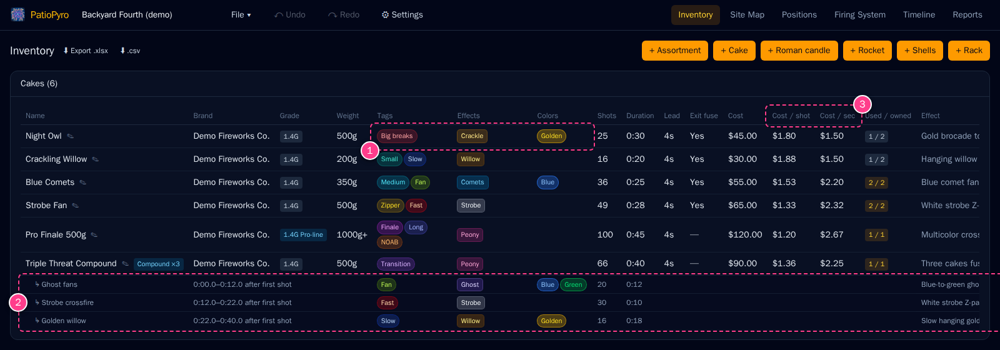

1. **Labels:** tags for how a cake fires, effects for what it looks like, and colors, each shown in the color it names.
2. **Compound cakes:** the fused sub cakes, each with its own timing, shots and labels. The cake's shots and duration are worked out from them.
3. **Cost per shot and per second**, so you can compare cakes of different sizes.

### Site map

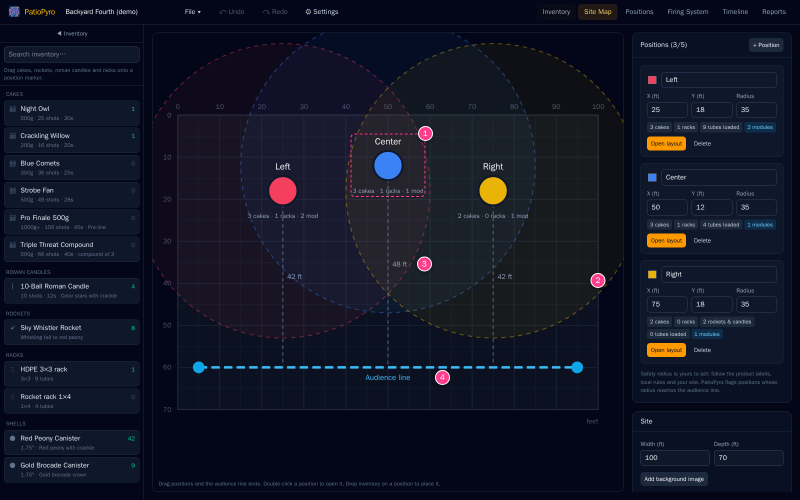

1. **Positions:** up to five, dragged into place on a to-scale yard. Each shows what's placed there.
2. **Safety radius** around each position.
3. **Distance to the audience line**, shown in red when a position is too close.
4. **Audience line:** drag either end to match your site.

## Build

### Position canvas

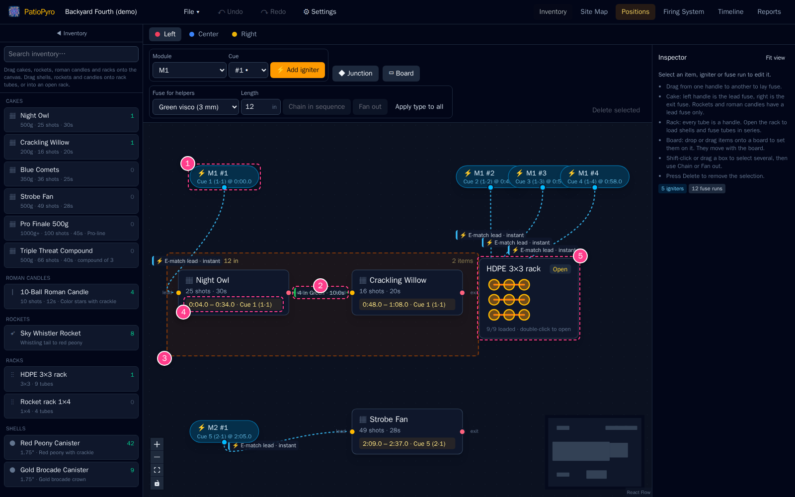

1. **Igniter** on a module cue. Its e-match lead lights what it touches at the cue time.
2. **Fuse run** with its length, fuse type and burn time.
3. **Board** drawn to scale. Items on it move with it.
4. **Fire window:** when each cake starts and stops firing, worked out from the cue time and every fuse on the way.
5. **Rack:** double-click to open the rack editor.

### Rack editor

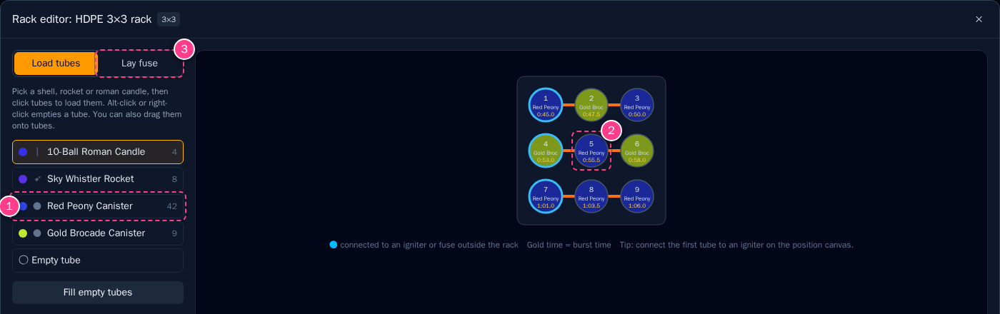

1. **Pick what to load:** a shell, rocket or roman candle, then click or drag onto tubes.
2. **Each tube** shows its number, what's in it and its burst time.
3. **Lay fuse** by clicking tubes in order, or series-fuse the whole rack in one click.

## Program

### Firing system

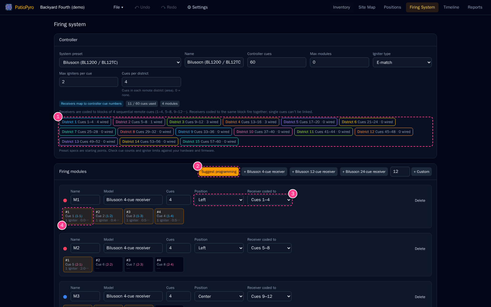

1. **Districts:** the cues in each remote district and how many are wired.
2. **Suggest programming** puts receivers in the order they fire, keeping each inside one district.
3. **Modules** are assigned to a position and coded to a block of cues.
4. **Each cue** shows its controller cue, its place in the district and how many igniters are on it.

### Timeline

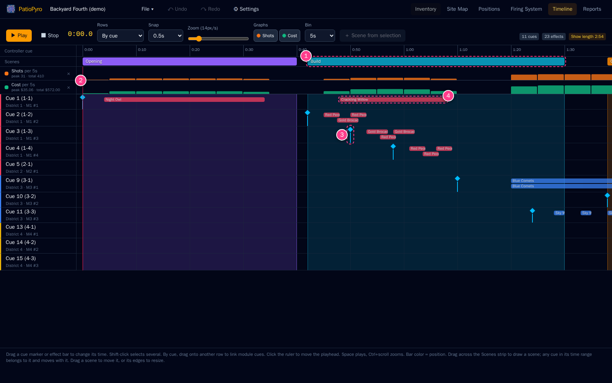

1. **Scenes:** named, colored sections. Drag one to move its cues with it.
2. **Shots and cost graphs**, per 5 s, so you can see how the show builds.
3. **Cue markers:** drag in time with snapping, or onto another row to link cues.
4. **Effect bars:** everything each cue fires, from ignition to the last burst.

## Show day

### Reports

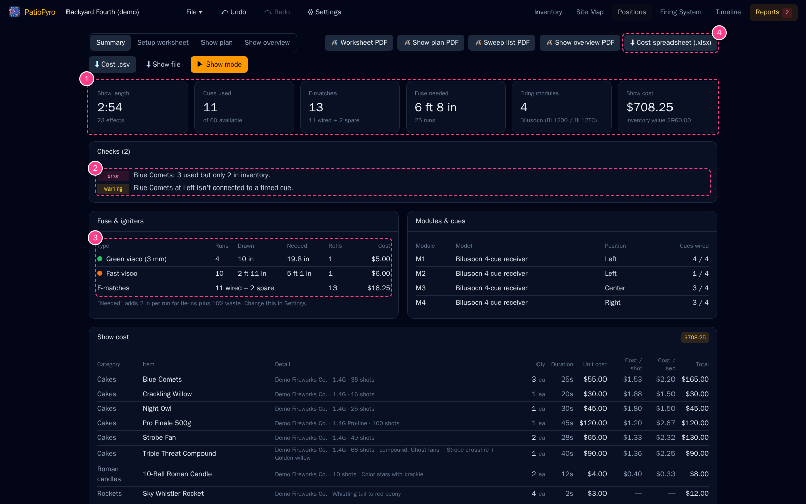

1. **At a glance:** show length, cues, e-matches, fuse, modules and cost.
2. **Checks:** over-used inventory, unconnected items, too many igniters per cue, cues out of range and positions too close to the audience.
3. **Fuse and igniters:** what to buy, with tie-in allowance, waste and rolls.
4. **Exports:** printable worksheet, show plan, sweep list and overview, plus the cost spreadsheet.

### Setup worksheet

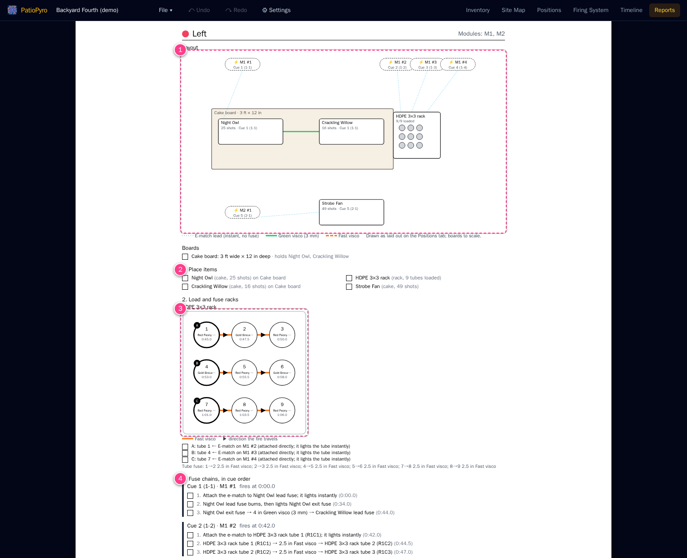

1. **Position layout**, drawn from the position canvas, boards to scale.
2. **Placement checklist**, by board.
3. **Rack loading and fuse diagram:** what goes in each tube, fuse type and the direction the fire travels.
4. **Fuse chains**, step by step in cue order, with the time each link lights.

### Show overview

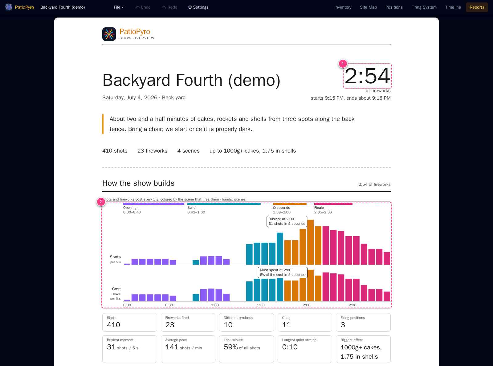

1. **Headline:** run time, start and end, and a short description.
2. **How the show builds:** shots and spend over time, colored by scene, with the busiest moment marked.

Choose which sections to print (scene by scene, what's in the show, cost, safety and site), in portrait or landscape.

### Show mode

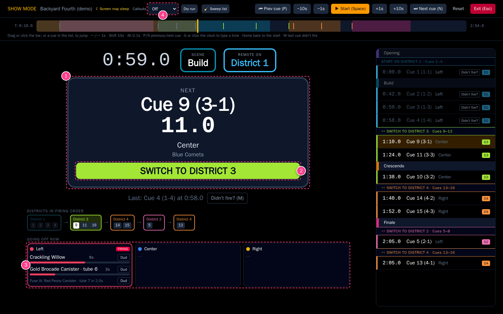

1. **Next cue:** a big countdown, with where and what it fires.
2. **District callout:** when to switch the remote, as soon as the cue before the switch fires.
3. **Going off now** at each position, with a Dud button for anything that doesn't go off.
4. **Callouts:** beeps or spoken warnings before each cue.

### Dry run

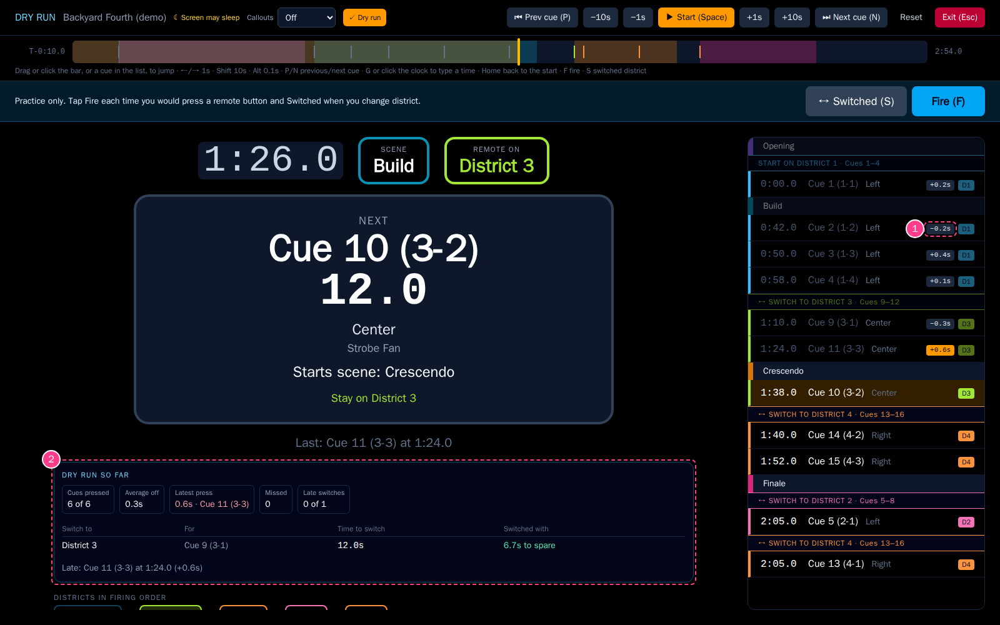

1. **Each cue** shows how early or late you pressed Fire.
2. **Results so far:** cues pressed, average offset, misses, and how much time you had to spare for each district switch.

After the real show, the **Sweep list** prints everything still live: duds, cues that didn't fire, and what they would have lit.
